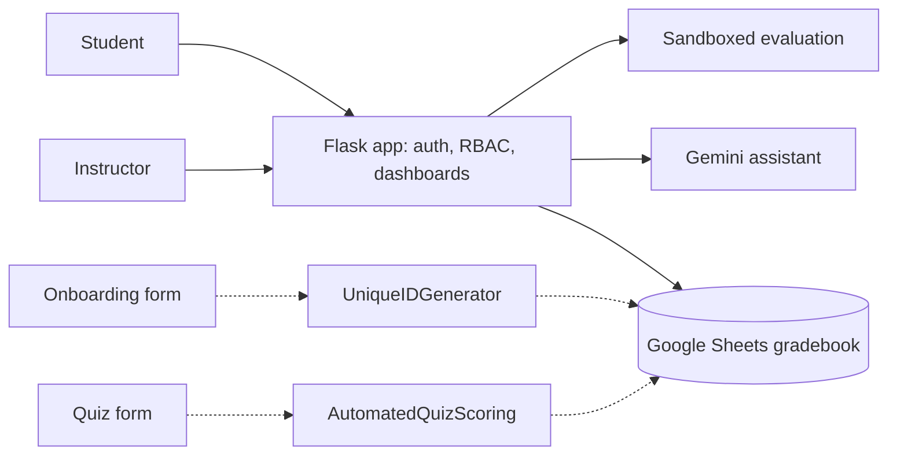

# EvaluatingCodeSpace

A browser-based platform for evaluating student code. Instructors create assignments with test cases, students submit code, and the platform runs it in a sandbox, shows per-test results, and syncs scores to a Google Sheets gradebook. A Gemini-powered assistant helps students with concepts without giving away answers.

**Status:** core engine, dashboards and gradebook sync are working. Some pieces are still planned (see [Status](#status)).
**Author:** Shrishailya Keskar

## What it does

| Role | Can do |
|---|---|
| **Instructor** | create and edit assignments, define public and hidden test cases (JSON), review submissions, grade with feedback |
| **Student** | see pending assignments, submit code, see verdicts per test case, review past submissions |
| **Admin** | assign roles and manage users |

- **Sandboxed execution:** submissions run in isolated containers with limited resources. TODO(owner): confirm which executor is used today (Docker sandbox or self-hosted Judge0).
- **Login:** Google OAuth 2.0, role-based access control, CSRF protection.
- **Assistant:** Gemini chatbot available on every page, built to explain and hint rather than give answers.
- **Gradebook:** scores are written to a Google Sheet automatically.

## How the parts fit


Dashed lines are the Apps Script helpers below. TODO(owner): mark each as "connected" or "planned" once confirmed.

## Components

| Repo | Role |
|---|---|
| [UniqueIDGenrator](https://github.com/hecker03/UniqueIDGenrator) | Google Apps Script that gives each form response a unique alphanumeric ID, used to onboard and track students |
| [AutomatedQuizScoring](https://github.com/hecker03/AutomatedQuizScoring) | Google Apps Script that scores quiz responses and copies results into a grade sheet |

## Tech stack

Python, Flask, SQLAlchemy, MySQL, Google Gemini API, Authlib (OAuth), Flask-WTF, Docker, HTML/CSS/JavaScript.

## Run it locally

**Needs:** Python 3.8+, MySQL, Docker Desktop (running), a Google Cloud project for OAuth and Gemini.

```bash
git clone https://github.com/hecker03/EvaluatingCodeSpace.git
cd EvaluatingCodeSpace
python -m venv venv
source venv/Scripts/activate        # Windows Git Bash. Linux/macOS: source venv/bin/activate
pip install -r requirements.txt
cp .env.example .env                # then fill in your own values
python run_dev.py
```
Open `http://localhost:5000`. `db.sql` holds the schema only; import it into an empty database first.

**Never commit `.env`, service-account JSON files or database dumps with real users.** They are in `.gitignore`.

## Test case format

```json
[
  { "input": "5\n", "output": "120\n" },
  { "input": "3\n", "output": "6\n" }
]
```

## Status

| Area | State |
|---|---|
| Code evaluation engine | done |
| Instructor and student dashboards | done |
| Google Sheets gradebook sync | done |
| Gemini assistant | done |
| Unique ID onboarding (UniqueIDGenrator) | TODO(owner): connected or planned |
| Quiz scoring (AutomatedQuizScoring) | TODO(owner): connected or planned |
| E-certificate generator | planned |
| Resource hub (PDFs, videos, snippets) | planned |
| Verdict rendering | minor issues under review |

## Security notes

- Credentials come from environment variables; the repo ships `.env.example` only.
- Earlier development history is kept in a private archive, because it contained local credentials that have since been rotated.

## Roadmap

- E-certificate generator for course completion
- Resource hub for course material
- Instructor control over hidden test cases
- Analytics dashboard

## License

MIT
